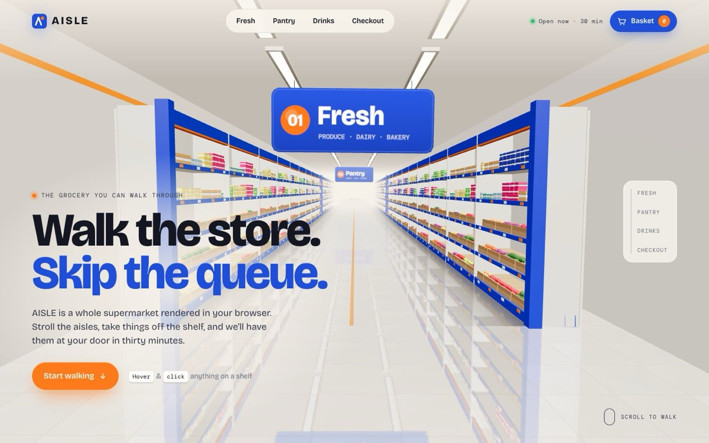

# AISLE — walk the store in 3D

[](https://tabishhassan5121472.github.io/aisle-3d-market/)


An online grocery landing page where you scroll your way down a supermarket aisle built in WebGL, take products off the shelf, and watch them land in your basket.

**Live demo:** [https://tabishhassan5121472.github.io/aisle-3d-market/](https://tabishhassan5121472.github.io/aisle-3d-market/)

## Techniques
- **three.js 0.160** scene built entirely in code: shelving, crates, checkout lanes, light strips, and signs. There are no models or images.
- **InstancedMesh** for every product type (boxes, cans, `LatheGeometry` bottles, fruit spheres). The desktop store holds about 8,500 products and mobile about 4,100.
- A custom `onBeforeCompile` shader adds a printed label band and a pulsing hover/selection glow per instance (via `gl_InstanceID`).
- A reflective tiled floor (`Reflector` under a glossy, semi-transparent plane), a `RoomEnvironment` PMREM for lighting, fog, and soft contact-shadow strips.
- Hanging aisle signs and an end-wall mural drawn on canvas 2D textures.
- **GSAP ScrollTrigger + Lenis**: scroll moves the camera down the aisle along an eased keyframe path with head-bob, turns toward the shelves, and pointer parallax. The Fresh / Pantry / Drinks / Checkout chapters fade in at set points.
- Raycast hover highlighting. Clicking a product opens a floating card that follows it in screen space. "Add" lifts the product off the shelf and flies a dot along a bezier into the nav basket, which bumps.
- The page respects `prefers-reduced-motion`, caps DPR, and pauses rendering when the aisle is scrolled away or the tab is hidden. Mobile uses fewer instances and no reflector.

Plain HTML/CSS/JS, no build step. Designed & built by [Tabish Hassan](https://github.com/tabishhassan5121472).


## Run locally

```bash
npx serve .
```

## License

MIT — free to learn from and reuse.
